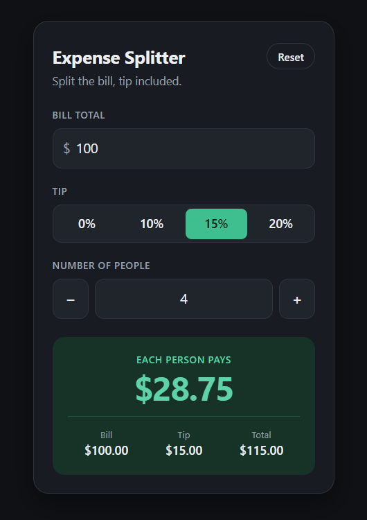
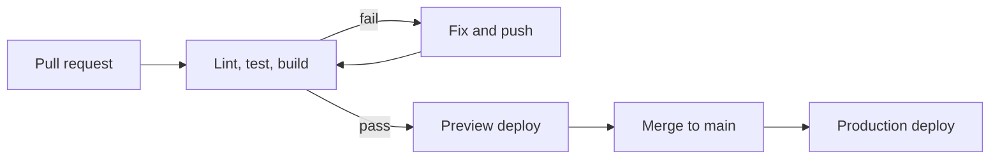
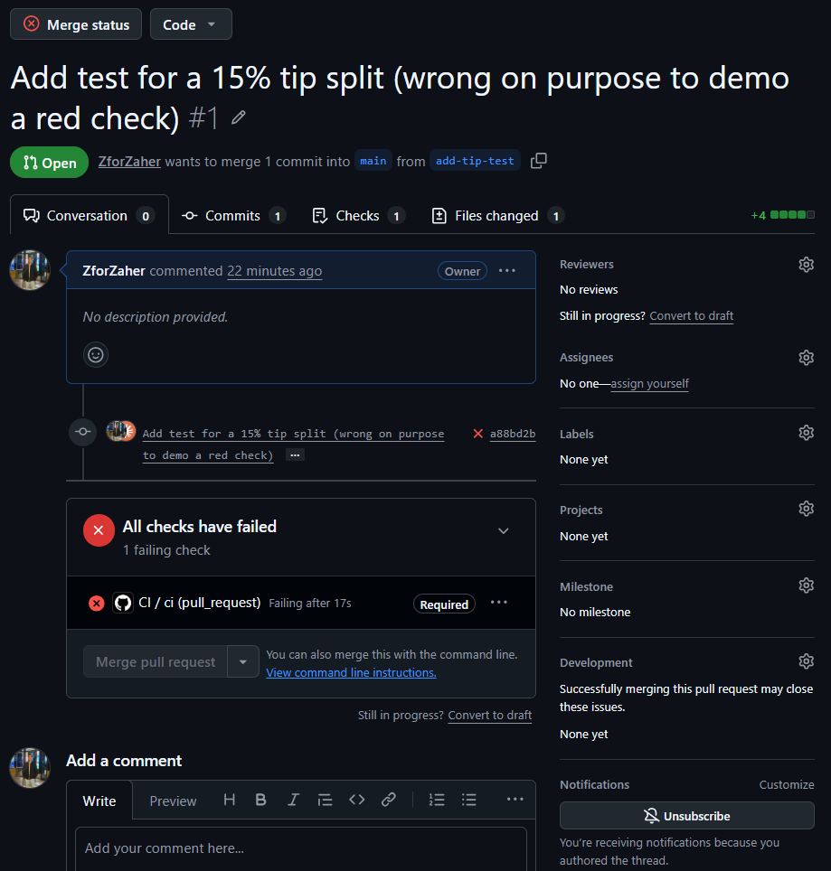

# Expense Splitter

[](https://github.com/ZforZaher/expense-splitter/actions/workflows/ci.yml)

**Live site:** <!-- TODO: https://YOUR-SITE.netlify.app -->

A small React app that splits a bill, tip included, between any number of people.



## How the pipeline works



- **Every pull request** runs `npm ci`, lint, tests with an 80% coverage gate, and a production build in GitHub Actions.
- **Passing pull requests** get their own Netlify preview URL, posted as a comment on the pull request. Production is never touched.
- **Merging to `main`** runs the same checks again, then deploys to production. Nothing reaches the live site without passing CI.
- **The deploy jobs reuse the build artifact** from the CI job, so the site that goes live is the exact build that was tested.
- **npm dependencies are cached** between runs by `actions/setup-node`.
- **Newer pushes cancel older runs** on the same pull request. Runs on `main` are never cancelled, so a deploy is never cut off halfway.

## Quality gates

| Gate | Tool | Fails the build when |
| --- | --- | --- |
| Lint | ESLint | Any lint error |
| Tests | Vitest + React Testing Library | Any test fails |
| Coverage | `@vitest/coverage-v8` | Lines, functions, branches or statements drop below 80% |
| Build | Vite | The production build fails |
| Branch protection | GitHub ruleset | `main` can only change through a pull request with a green `ci` check |

A pull request with a failing test cannot be merged:



## Results

<!-- TODO: fill in from the "Install dependencies" step of two CI runs -->

| Measure | Value |
| --- | --- |
| `npm ci` without cache | _X s_ |
| `npm ci` with cache | _Y s_ |
| Test coverage (lines) | _Z %_ |

## Run it locally

Requires Node.js 24.

```bash
npm ci            # install exact dependency versions
npm run dev       # start the dev server
npm run coverage  # run tests with the coverage gate
```

Secrets (`NETLIFY_AUTH_TOKEN`, `NETLIFY_SITE_ID`) live only in GitHub Actions secrets and are never committed.
